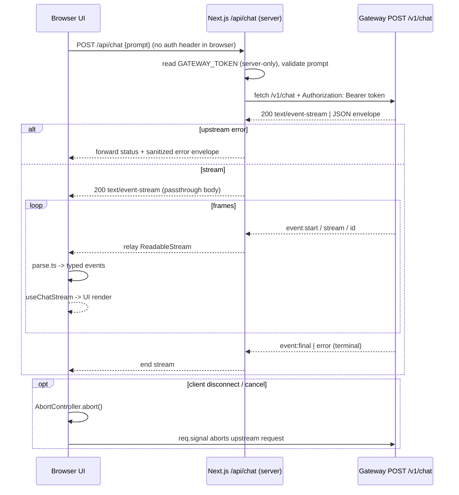

# TDD: FEAT-00015 — Next.js UI + Server-Side Token Proxy

**Author:** Architect  |  **Date:** 2026-08-07  |  **Status:** Draft (Flow 1 → Design)

- Flow entry: `.gemini/PROJECT_FLOWS.md` **Flow 1 (New Feature) — Design phase**
- Registry: `docs/REGISTRY.md` `FEAT-00015` (P2 / S2 / **DEFERRED** → activate)
- Source of truth for seams: `docs/tdd/FEAT-00008_gateway_tdd.md`, `docs/specs/api/gateway.md`
- Contract consumed: **frozen** `POST /v1/chat` SSE (`ADR-00002/03/04`) — no gateway change.

---

## 1. Problem Statement

The gateway (`FEAT-00008`) exposes a chat endpoint over SSE, but only a headless
client (`curl`/programmatic) can reach it directly: the browser **cannot** send an
`Authorization` header via `EventSource`, and shipping the `GATEWAY_API_TOKEN` into
a client bundle would leak the shared secret (`ADR-00004`). Today there is no
human-facing way to chat with the agent.

We want a browser UI that:

- lets a user type a prompt and see the live SSE stream render,
- shows tool-in-progress and streamed errors, and
- reaches the gateway **without ever exposing the token to the browser**.

Constraint: the Go code (`cmd/*`, `internal/*`) is **unchanged and additive-free**;
this feature is a new `web/` workspace in the monorepo. Success metric: a user
opens `http://localhost:3000`, sends a prompt, sees `start → stream* → final|error`
rendered live, and the token is verified absent from the served JS.

---

## 2. Proposed Design

### 2.1 System Architecture

```mermaid
graph TD
    subgraph Browser
        UI[Next.js App Router UI]
        Hook[useChatStream hook]
    end
    subgraph web/ Next.js server
        Proxy[route handler /api/chat - stream proxy]
        Layout[app/layout + page]
    end
    subgraph Go Gateway (unchanged FEAT-00008)
        GW[POST /v1/chat SSE]
        Auth[Bearer middleware]
    end
    subgraph Server side
        MCP[Filesystem MCP]
    end
    Browser -->|fetch /api/chat| Proxy
    Proxy -->|fetch-stream + Bearer header| GW
    GW --> Auth
    Auth --> GW
    GW --> MCP
    Hook -->|render| UI

    style Proxy fill:#eef
    style GW fill:#fdd
```

**Trust boundary (`rules/security.md`):** the token lives in `web/.env` (server-side),
read **only** inside the route handler (`app/api/chat/route.ts`). The Route Handler
runs in the Next.js Node runtime (server), calls the gateway with the
`Authorization` header, and streams the response body back to the browser. The
browser only ever talks to `/api/chat` — the header is constructed server-side and
never appears in client code.

### 2.2 Module Boundaries & New Packages

| Path (under `web/`) | Responsibility | Ever client-side? | New? |
| --- | --- | --- | --- |
| `package.json`, `tsconfig.json`, `next.config.mjs`, ESLint/Prettier | toolchain + scripts + CI gate | — | new |
| `app/layout.tsx`, `app/page.tsx` | App Router server page (renders client components) | server | new |
| `app/api/chat/route.ts` | **BFF proxy**: read token, `fetch` gateway, relay SSE body | **server-only** | new |
| `lib/chat/parse.ts` | decode `ReadableStream` into SSE frames (`event:`/`data:`/`id:`) | browser | new |
| `lib/chat/types.ts` | shared typed event union (`start`/`stream`/`final`/`error`/`id`) | browser | new |
| `hooks/useChatStream.ts` | stateful streaming hook (React) | browser (`"use client"`) | new |
| `components/ChatThread.tsx`, `MessageBubble.tsx`, `ToolEvent.tsx`, `ErrorBanner.tsx` | dumb presentational components | browser | new |
| `app/globals.css` (Tailwind) | styling | browser | new |

Principle (mirror of `ADR-00001` D1/D2): the Go code is untouched; Next.js is
additive. The server-only proxy (`route.ts`) is the single place that owns the
token and the only network client to the gateway.

### 2.3 Server-Side Token Proxy (the critical seam)

`app/api/chat/route.ts` — a **Next.js Route Handler** `POST` that:

1. Reads `GATEWAY_TOKEN` from `process.env` (server-side only; **never**
   `NEXT_PUBLIC_*`).
2. Validates `prompt` from the JSON body (non-empty string).
3. Calls the upstream gateway:
   `fetch(GATEWAY_URL + "/v1/chat", { method: "POST", headers: { "Content-Type": "application/json", Authorization: "Bearer " + token, Accept: "text/event-stream" }, body: JSON.stringify({ prompt }), signal: req.signal })`.
4. On a non-`200` upstream response, returns the gateway JSON envelope with its
   status code (does **not** forward the raw upstream header/body secrets).
5. On `200`, returns `new Response(upstream.body, { status: 200, headers: {
   "Content-Type": "text/event-stream", "Cache-Control": "no-cache",
   "X-Accel-Buffering": "no" } })` — **pipe the `ReadableStream` verbatim** (never
   `await resp.json()` / `resp.text()`), so flush semantics are preserved and the
   token is never in the payload.

Env vars (server side only, in `web/.env`):

| Variable | Required | Purpose |
| --- | --- | --- |
| `GATEWAY_URL` | Yes | e.g. `http://localhost:8080` |
| `GATEWAY_TOKEN` | Yes | the `GATEWAY_API_TOKEN` value; never `NEXT_PUBLIC_*` |

### 2.4 Client-Side SSE decode (`lib/chat/parse.ts`)

The browser uses `fetch` + `resp.body.getReader()` (NOT `EventSource` — it cannot
send a POST body, `ADR-00002`). A stream parser accumulates a byte buffer, splits
on `\n\n`, and parses lines `event:` / `data:` / `id:` into typed events
(`lib/chat/types.ts`). Output is a `ReadableStream` of parsed `ChatEvent[]`
consumed by `useChatStream`.

```ts
type ChatEvent =
  | { type: "start"; request_id: string; model: string }
  | { type: "stream"; data: TextEvent | ToolEvent }
  | { type: "final"; text: string }
  | { type: "error"; code: string; message: string }
  | { type: "id"; note: string };

type ToolEvent = { type: "tool"; name: string; status: "start" | "result"; bytes: number };
```

### 2.5 Endpoint / UI contract (internal, NOT a public API)

The browser UI is driven entirely through the proxy route `POST /api/chat`. There
is no new public endpoint; the frontend re-uses the **frozen gateway contract**
(`ADR-00003`). Existing `/v1/chat` is unchanged. All `api-convention.md` error
envelope rules apply at the proxy boundary (`error.code` UPPER_SNAKE_CASE,
`error.message` human-readable, no secrets).

### 2.6 Data Flow (Sequence)



The upstream request forwards `req.signal` so a browser abort aborts the gateway
request, matching the gateway's cancel handling (`GW5`).

### 2.7 Error Model

Errors before the proxy commits a `200` → forwarded JSON envelope → UI
`ErrorBanner`. In-stream `error` SSE event drives the same banner; terminal `final`
shows the answer. `CANCELLED` is shown as a non-terminal note when still
writable. The token is never part of any error payload.

---

## 3. Alternatives Considered

| Option | Pros | Cons | Why Not → Selection |
| --- | --- | --- | --- |
| **Next.js + server Route Handler proxy (fetch-stream passthrough)** | token stays server-side; verbatim body stream; same origin → no CORS | one more deployment (Node) | Selected |
| Browser `EventSource` direct to gateway | trivial | cannot send POST/headers → token in query/URL → leak (`ADR-00002/0004`); CORS | Rejected — the token would be in the URL, a transport-visible leak |
| build-time inject token into client bundle | simplest | **the defining leak**; violates `rules/security.md` | Rejected (never) |
| Vite/React SPA + separate proxy | similar | extra proxy + CORS + origin to manage | Rejected for MVP; Next.js gives BFF + Router free |
| Nginx/auth_proxy in front | can add | out-of-band infra | Rejected MVP (keep validation in-process) |

## 4. Risk & Mitigation

| Risk | Impact | Prob. | Mitigation |
| --- | --- | --- | --- |
| Token leaks into browser bundle (misuse `NEXT_PUBLIC_`, `.env` prefix) | High | Med | server-only `route.ts`; CI grep/audit fails on token-like value in build output; QC STRIDE review; `.env.example` holds placeholder only |
| Node fetch/SSR buffers so no live token stream | Medium | Med | pipe `upstream.body` passthrough (no `.json()`/`.text()`); `Cache-Control: no-cache`, `X-Accel-Buffering: no`; heartbeat passthrough |
| SSE parser mis-handles multibyte/split-mid-event chunks | Medium | Med | byte-buffer decoder; unit tests for partial `\n\n` splits and multi-byte boundary |
| UI scope creep beyond MVP | Medium | Med | MVP = single thread + tool + error; follow-up FEAT for history/persistence/auth |
| Second toolchain burden (Node in a Go repo) | Low | Med | isolate `web/` (own `package.json` + lockfile); dedicated CI gate (lint/typecheck/build); document commands |
| Empty-trailing event filtering | Low | Low | deterministic parser tests |

## 5. Rollout Plan

- **Phase 0 — Design (this TDD).** Approve TDD + ADRs (`ADR-0007` Next.js toolchain; `ADR-0008` BFF fetch-stream SSE proxy; `ADR-0009` `web/` CI gate).
- **Phase 1 — `web/` scaffold.** Next App Router, `tsconfig strict`, ESLint + Prettier, CI gate. Verify: `npm run lint && npm run typecheck && npm run build`.
- **Phase 2 — proxy + config.** `app/api/chat/route.ts` + `.env.example`; verify with running gateway + `curl localhost:3000/api/chat`.
- **Phase 3 — SSE client + hook.** `lib/chat/parse.ts` (+ unit tests), `hooks/useChatStream.ts`. Verify: `npm run test` green.
- **Phase 4 — UI page + components.** ChatThread, MessageBubble, ToolEvent, ErrorBanner; wire the streaming render. Verify: `npm run dev` chat against real gateway.
- **Phase 5 — hardening.** Abort-propagation tests, token-absence CI assertion, docs.

**Rollback:** `web/` is additive; `cmd/server`, `cmd/gateway`, `internal/*` untouched. A defective UI is skipped (entrypoint absent) with no migration.

---

## 6. Acceptance Criteria

| ID | Criterion | Verification (automated where feasible) |
| --- | --- | --- |
| U1 | `POST /api/chat {prompt}` → UI renders `start`, tool `stream`, and `final` live as received. | integration test against a stub SSE server in `web/` |
| U2 | Token (`GATEWAY_TOKEN`) never present in any client artifact (JS, source maps, SSR HTML). | CI grep/audit scan + manual `curl` of built output; QC STRIDE review |
| U3 | Streamed `error` renders an error banner; terminal `final` shows answer. | parse + render integration test |
| U4 | Browser uses `fetch` + `ReadableStream` (no `EventSource`). | static/vitest guard |
| U5 | Proxy is passthrough: returns upstream SSE body without buffering (no `await resp.text()`). | code-review test asserts `resp.body` relay |
| U6 | Client abort aborts upstream gateway request via `AbortController`/`req.signal`. | integration test with stub SSE awaiting abort |
| U7 | Go unchanged: `go test ./...` and `go vet ./...` stay green. | CI go gate re-run |
| U8 | `web/` gate green: `npm run lint`, `npm run typecheck`, `npm run test`, `npm run build` in CI. | CI pipeline |
| U9 | No CORS needed: browser → Next.js is same-origin `/api/chat`. | same-origin integration test |

---

## 7. Test Strategy (matches `rules/testing.md`)

- **Unit (in `web/`):** SSE frame parser (partial `\n\n` split, multibyte boundary, mixed `event:`/`data:`/`id:`), event mapping, prompt validation; proxy with a stubbed gateway `fetch`.
- **Integration:** proxy route against an in-process fake HTTP SSE server — assert `200`, content-type, body passthrough, and abort propagation.
- **E2E (opt-in):** real gateway (`cmd/gateway` on `:8080` token) + real Gemini/Filesystem MCP behind credentials — never the dev `D:\Mihi`. Skipped in CI unless token env present.
- **Gates:** `go test ./...` + `go vet ./...` (Go unchanged); `web/`: `npm run lint`, `npm run typecheck`, `npm run test`, `npm run build`. TS strict, no `any` (`code-style.md` Part B).
- Coverage: parser + proxy ≥80% statement coverage; UI components visual/live.

## 8. Recommended Build Sequence

1. **Phase 1** `web/` scaffold + CI gate (verify lint/typecheck/build green).
2. **Phase 2** proxy route + config + `.env.example` (verify with `curl` against live gateway).
3. **Phase 3** SSE parser + hook (TDD: failing parser tests first).
4. **Phase 4** components + page + streaming render.
5. **Phase 5** hardening (abort tests, token-absence guard, docs).

**Guard-rail:** never reference `GATEWAY_TOKEN` in any client-bundled file
(`NEXT_PUBLIC_*`, `"use client"` exports). Add a CI grep/audit fail-out if a
token-like value appears in build output.

## 9. Open Questions

- [ ] Confirm `GATEWAY_TOKEN` equals the gateway `GATEWAY_API_TOKEN` value, and that a per-env token rotation workflow is acceptable (no secrets at rest).
- [ ] Confirm default Next.js port `:3000` does not conflict with gateway `:8080`.
- [ ] Pin Next.js major version (e.g. 16 LTS) given Node v24 / npm 11 in repo env.
- [ ] Map gateway `error.code` → human copy in the UI (base set in `gateway.md`).

## 10. References

- `docs/tdd/FEAT-00008_gateway_tdd.md`, `docs/specs/api/gateway.md`
- `docs/adr/ADR-0001..ADR-0009` (new: `ADR-0007` Next.js web workspace, `ADR-0008`
  BFF fetch-stream SSE proxy, `ADR-0009` `web/` CI gate)
- `docs/tdd/MCP_HOST_TDD.md`
- `rules/`: `security.md`, `code-style.md` (Part B), `testing.md`, `api-convention.md`, `git-workflow.md`
- Node `v24`, `npm 11` (available); Go `1.26` — untouched.