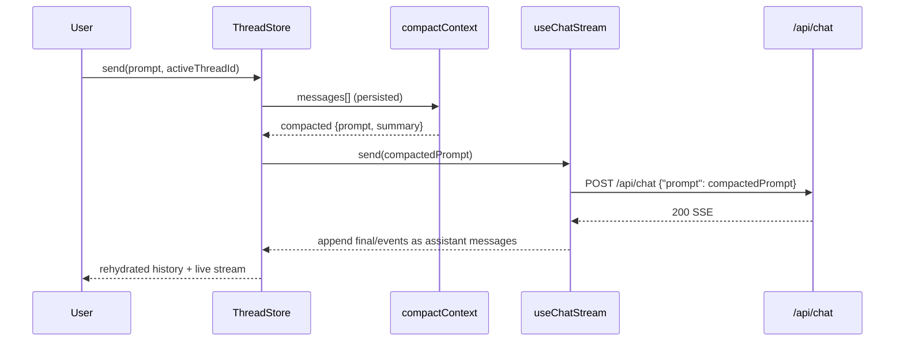

# TDD: FEAT-00021 — Multi-Thread Chat + History Cache + Input-Token Reduction

**Author:** Architect | **Date:** 2026-08-07 | **Status:** Draft (Flow 1 → Design)

- Flow entry: `.gemini/PROJECT_FLOWS.md` **Flow 1 (New Feature) — Design phase**
- Registry: `docs/REGISTRY.md` `FEAT-00021` (P1 / S3 / **BACKLOG**; sub-tasks FEAT-00022..00025)
- Design ADR: `docs/adr/ADR-0010-client-thread-cache-compaction.md`
- Source seams: `FEAT-00015` web UI (`web/`), frozen `POST /v1/chat` (ADR-00003)

---

## 1. Problem Statement

`POST /v1/chat` accepts only `{prompt}` (frozen, ADR-00003). The FEAT-00015 web UI
(`web/`) sends one prompt and discards all prior turns. Every message is an independent,
context-free call: the conversation is fragmented and, to gain continuity, a client
would re-send the whole history each turn — input-token cost grows O(full history).

We want:
- **threads**: multiple named conversations the user can create, switch, and archive;
- **continuity**: continuing a thread carries prior context;
- **bounded tokens**: input-token load per continued turn drops (window + summary),
  not grows, vs naive full-history resend.

Constraint: the Go tree stays untouched and the gateway `POST /v1/chat` contract is
unchanged. Success metric: from `http://localhost:3000` a user opens/creates a thread,
sends a prompt, switches between threads, and the continued-turn prompt is smaller than
full-history resend while preserving the last K turns and a summary of older context.

---

## 2. Proposed Design (ADR-0010: client-only compaction)

### 2.1 System Architecture

```mermaid
graph TD
    subgraph Browser
        Store[(localStorage thread store)]
        Thumb[ThreadList rail]
        Active[ActiveThreadView]
        Hook[useChatStream]
        Comp[Compactor]
    end
    subgraph web/ (unchanged seams from FEAT-00015)
        Proxy[POST /api/chat BFF proxy]
    end
    subgraph Go Gateway (unchanged FEAT-00008)
        GW[POST /v1/chat SSE]
    end
    User -->|create/switch/archive| Thumb
    User -->|type| Active
    Active --> Comp
    Comp -->|compacted prompt| Hook
    Hook -->|fetch /api/chat {prompt}| Proxy
    Proxy -->|Bearer + {prompt}| GW
    GW -->|SSE| Proxy -->|stream| Hook --> Active
    Active -->|append msgs| Store[thread store]
    Store -->|rehydrate on load| UI
```

The token stays server-side in the BFF proxy (`ADR-0008`); the thread store and
compaction are purely client-side.

### 2.2 Client Data Model (localStorage; no DB, no migration)

```ts
type ThreadMessage = { role: "user" | "assistant"; kind: "text" | "tool"; text: string; ts: number };

type Thread = {
  id: string;              // nanoid/crypto.randomUUID()
  title: string;          // derived from first user prompt
  createdAt: number;
  updatedAt: number;
  messages: ThreadMessage[];
  summary?: string;       // compaction summary of older prefix (populated when > window)
};

type ThreadStoreState = {
  threads: Thread[];
  activeId: string | null;
};
```

Storage key under `localStorage`: `mcp.chat.threads:v1:v0`.
Manual (dev) override: `mcp.chat.threads:v1:v1` for migration tests.

### 2.3 Compaction Strategy (the core)

`compactContext(thread, opts): { prompt, summary }`
- Keep the **last `window` (default 6, configurable)** messages verbatim.
- If `thread.messages.length > window` and `thread.summary` exists → prepend
  `"[Earlier context] <summary>"`.
- For MVP the `window` + prefix-lossy approach is used (deterministic, no gateway call).
- **Input-token assertion (AC-3):** the compacted prompt's serialized size must be
  `< full-history serialized size` when the thread exceeds the window — i.e. growth is
  bounded by `O(window + summary)`, not `O(history)`.

### 2.4 Data Flow (continued turn)



### 2.5 Env / Config Seam

- `NEXT_PUBLIC_THREAD_WINDOW` (client) — default `6`; override for the compaction window.
- No secrets involved; threads never contain the `GATEWAY_TOKEN`.

---

## 3. Alternatives Considered

| Option | Pros | Cons | Why Not → Selection |
|---|---|---|---|
| **Client-only thread store + windowed compaction (ADR-010)** | no Go change; frozen contract; bounded tokens; zero infra | heuristic/lossy until /summarize; localStorage quota | **Selected** |
| Server-side session store + gateway `context` param | strongest continuation + token sharing | breaks frozen contract; Go change; server DB | Rejected now (possible FEAT follow-up) |
| Re-send full history in `prompt` | trivial continuity | input-token grows O(full); recreates the token waste | Rejected |
| `/summarize` gateway LLM compaction only, no window | better quality | Go change; more latency/cost per turn | Deferred (seam reserved) |
| IndexedDB instead of localStorage | handles large/structured | async complexity at MVP; no benefit | Rejected |

---

## 4. Risk & Mitigation

| Risk | Impact | Prob. | Mitigation |
|---|---|---|---|
| localStorage quota (5MB) hit on long/many threads | Med | Med | FEAT-00025 caps (N threads, M messages); eviction oldest-fit |
| Compaction drops important older context (lossy) | Med | Med | keep window + summary placeholder; `/summarize` seam nowhared for MVP; UI shows "earlier context omitted" |
| Threads cached with user data → XSS/PII | Med | Low | sanitize on render (text as text); no secrets ever in thread (token never client); no eval |
| Migration/version skew of stored schema | Low | Low | versioned key `v1`; dev-only migration helpers; tests |
| Abort / switching threads mid-stream races | Med | Med | per-thread controller abort on switch (reuse pattern U-6); unit tests |
| UI scope creep beyond MVP | Med | Med | MVP = threads + window + summary flag; history/github follow-ups |

---

## 6. Acceptance Criteria

| ID | Criterion | Verification |
|---|---|---|
| U1 | Create/switch/archive threads; each thread keeps its message history | localStorage persistence + thread store / UI tests |
| U2 | Rehydrate last active (or a selected) thread on page reload | seed store → reload-equivalent rehydrate test |
| U3 | **Token reduction**: continued-turn compacted prompt ≤ full-history prompt for a message count above the window | unit test (byte/size comparison, AC-3) |
| U4 | Compaction keeps the last `window` messages + summary placeholder; older prefix flagged | unit tests (boundary at window, at window+1) |
| U5 | Streaming still works per thread and appends to that thread's history | integration with stub SSE (reuse FEAT-00015 pattern) |
| U6 | Switching/aborting a thread cancels its in-flight request cleanly (no orphan) | abort-on-switch unit/integration test |
| U7 | Go untouched: `go test ./...` + `go vet ./...` green | CI go gate |
| U8 | `web/` gates green (lint/typecheck/test/build/audit:token) | CI; audit:token still PASS (no secret in threads) |
| U9 | Thread data cached locally; no gateway contract or new endpoint | code review: no new endpoint; AST/static no-change to route.ts contract |
| U10 | **Security:** no secrets/PII stored in threads; sanitized render | cache-content audit (threads never contain GATEWAY_TOKEN) + render sanitization test |

---

## 7. Test Strategy (matches rules/testing.md)

- **Unit:** compactor boundary (window, window+X, summary presence, byte-comparison U3),
  thread store CRUD + persistence round-trip, migration/version, sanitization.
- **Integration:** thread store × useChatStream append flow with a stub SSE; abort-on-switch.
- **E2E (opt-in):** real gateway — create thread, chat, switch, return; verify continuity
  and that the NE2E gateway still sees only `{prompt}` (unchanged).
- **Gates:** Go unchanged green; web typecheck/lint/test/build/audit:token green.

---

## 8. Recommended Build Sequence

1. **FEAT-00022:** thread model + store + localStorage + rehydrate (tests).
2. **FEAT-00023:** compaction window + summary seam + U3 byte-bound test.
3. **FEAT-00024:** thread UI rail + switcher + cached-history view.
4. **FEAT-00025:** caps/eviction, token-budget guard, crossover/abort tests, docs, security.

## 9. Open Questions

- [ ] Confirm the compaction window (default 6) and summary seam (`/summarize`) timing.
- [ ] Confirm localStorage (vs IndexedDB) and the 5MB cap for MVP.
- [ ] Confirm thread title derivation (first-prompt prefix, e.g. 40 chars).

## 10. References

- `docs/tdd/FEAT-00015_nextjs_ui_proxy_tdd.md` (U-4 no EventSource, U-2 token, AC-9/10 gates)
- `docs/specs/api/gateway.md` (frozen `{prompt}`), `docs/specs/api/web-ui.md`
- ADRs `0003`, `0007`, `0008`, `0009`, `0010` (this design)
- GA custom package: no; client-only. Web custom: yes (thread store/compactor/hook)